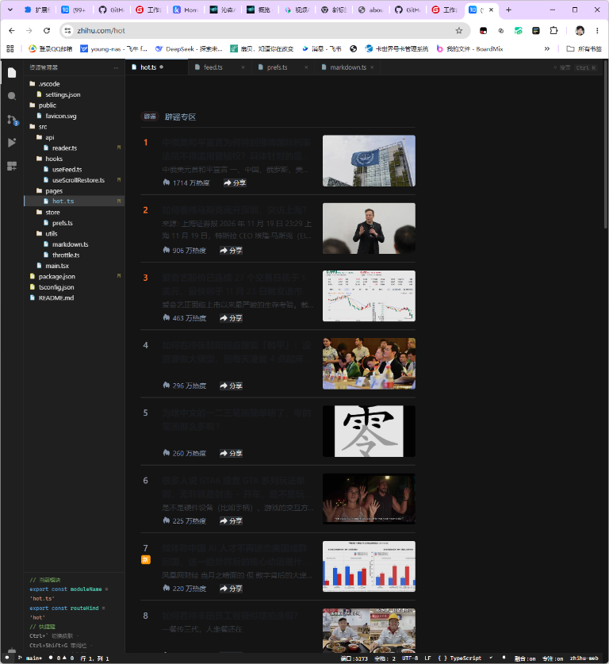
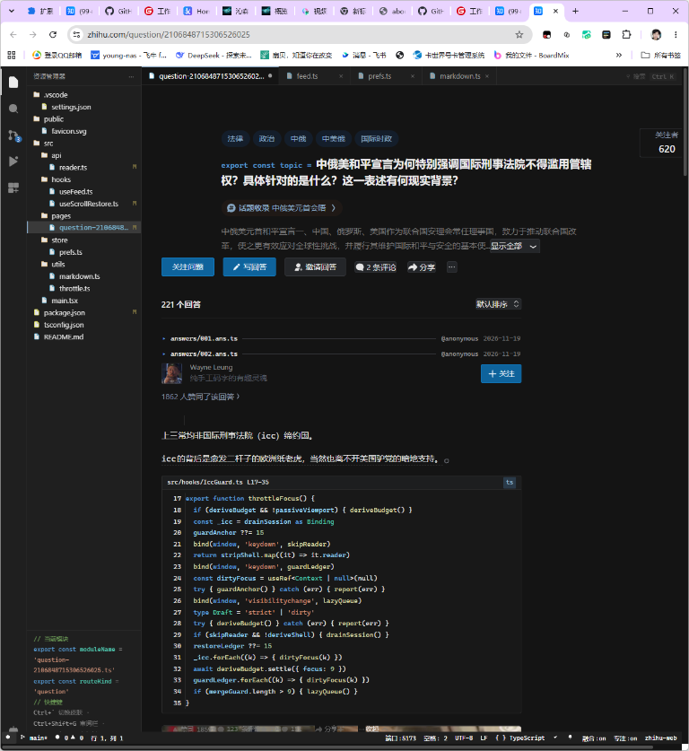
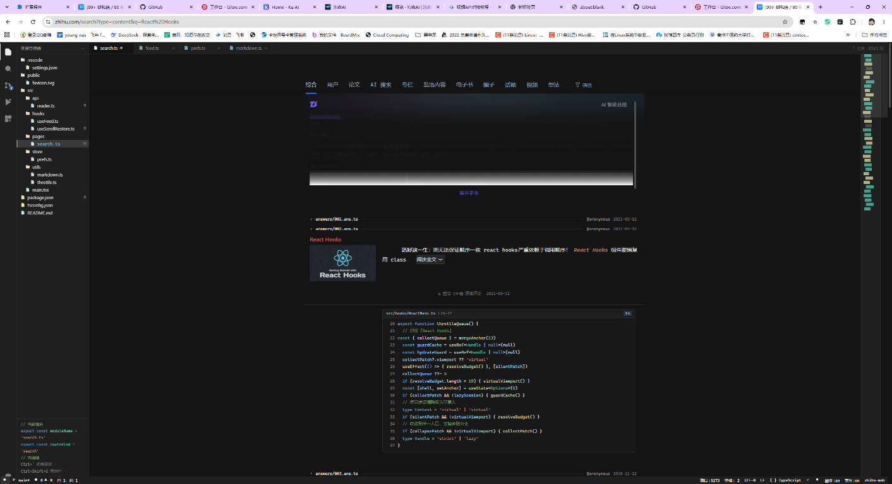

# 知乎 · 暗色 IDE 皮肤

把知乎重绘成你天天打交道的暗色 IDE：左边活动栏和文件树，上面标签页和面包屑，右下角 minimap 和状态栏，回答按代码编辑器排版。不改变知乎的任何内容，只换一层皮。

- GitHub：[dfdbb/zhihu-dark-ide](https://github.com/dfdbb/zhihu-dark-ide)
- Gitee 镜像（国内访问更快）：[youngforguo/zhihu-dark-ide](https://gitee.com/youngforguo/zhihu-dark-ide)





## 它长什么样

- **整站接管**：首页信息流、搜索结果、专栏列表、回答页、文章页都在同一套暗色 IDE 界面里，不是简单加个深色背景。
- **正文按代码编辑器排版**：等宽字体、行号槽、代码块高亮、标题栏显示所在「文件」。
- **两种版式，随时切换**
  - 融合：问答内容像代码单元一样插进正文流，跟段落同步出现。
  - 分栏：右侧一条变更审阅（diff），用 `+/-` 标出观点、数据和引用。
- **悬浮搜索**：鼠标靠近标签栏右上角，搜索框滑出；也可以直接 `Ctrl + K`。搜索结果会被拆成一行行「文件」，点开就是正文。
- **专注模式**：隐藏顶部站内导航和右侧推荐、广告，只留内容。
- **老板键**：一键还原成原版知乎，再按一次回来。



## 安装

### 方式一：Chrome / Edge 加载扩展（推荐）

1. 下载本仓库：`Code → Download ZIP`，或者 `git clone https://github.com/dfdbb/zhihu-dark-ide.git`。
2. 打开 `chrome://extensions`（Edge 为 `edge://extensions`）。
3. 打开右上角「开发者模式」。
4. 点「加载已解压的扩展程序」，选择仓库根目录（含 `manifest.json` 的那一层）。
5. 打开或刷新知乎。

> Chrome 重启后如果提示「关闭开发者模式扩展程序」，点「保留」即可。
> 更新代码后，在扩展卡片上点刷新按钮重新加载。

### 方式二：油猴脚本（Tampermonkey / 篡改猴）

1. 安装 [Tampermonkey](https://www.tampermonkey.net/)。
2. 打开 `dist/zhihu-ide.user.js` 的 Raw 地址，脚本管理器会自动弹出安装页。
3. 确认安装，刷新知乎。

脚本与扩展是同一份核心代码，功能一致。

## 快捷键

| 操作 | 快捷键 |
| --- | --- |
| 开关皮肤 | `Ctrl + \`` |
| 搜索 | `Ctrl + K` 或 `Ctrl + Shift + F` |
| 老板键（还原原版页面） | `Ctrl + Shift + H` 或 `Ctrl + Shift + Q` |
| 专注模式 | `Ctrl + Shift + B` |
| 融合 / 分栏切换 | `Ctrl + Shift + M` / `Ctrl + Shift + G` |

手机上不适用，只面向桌面浏览器。皮肤可以随时关掉，开关会记在本地。

## 隐私

- 所有代码都在你的浏览器里本地运行，**不发起任何网络请求**，**不采集任何数据**。
- 不申请任何扩展权限（`permissions` 为空），只通过内容脚本改样式。
- 浏览器里只存四个开关状态（`zhihu-ide:*`），删掉扩展即清除。

## 已知限制

- 知乎前端结构经常变，改版后个别区域可能样式错位；遇到问题欢迎提 Issue，附上页面链接和截图。
- 只适配桌面端布局，窄屏和小程序页面不在范围内。
- 这是个人项目，不是知乎官方产品，与知乎没有任何关联。

## 开发

```bash
# 仓库结构
content.js                 # 核心脚本（样式 + 布局 + 交互），扩展直接加载
manifest.json              # Manifest V3
icons/                     # 图标
tools/build-userscript.mjs # 生成油猴版本
dist/zhihu-ide.user.js     # 由上面脚本生成，勿手改
docs/screenshots/          # README 截图
```

改完 `content.js` 后在 `chrome://extensions` 点刷新；要更新油猴版就运行：

```bash
node tools/build-userscript.mjs
```

## 贡献

- 发现样式问题：提 Issue，写清页面类型（首页 / 搜索 / 回答 / 文章）、浏览器版本和截图。
- 想改样式：欢迎 PR，建议一个 PR 只解决一个页面或一类元素，方便 review。
- 给知乎加暗色主题的选择器请尽量用结构选择器，少依赖会变的类名。

如果这个小项目让你的知乎顺眼了一点，欢迎点个 Star，也欢迎把它分享给同样泡在 IDE 里的朋友。

## License

[MIT](LICENSE)

---

## English

A Chrome/Edge extension and Tampermonkey userscript that re-skins zhihu.com as a dark IDE: activity bar, file explorer, tabs, minimap, status bar, and article bodies typeset like source code. Everything runs locally — no network requests, no data collection, no extension permissions.

Install: clone the repo, open `chrome://extensions`, enable Developer mode, click "Load unpacked" and pick the repo root. Or install `dist/zhihu-ide.user.js` with Tampermonkey.
